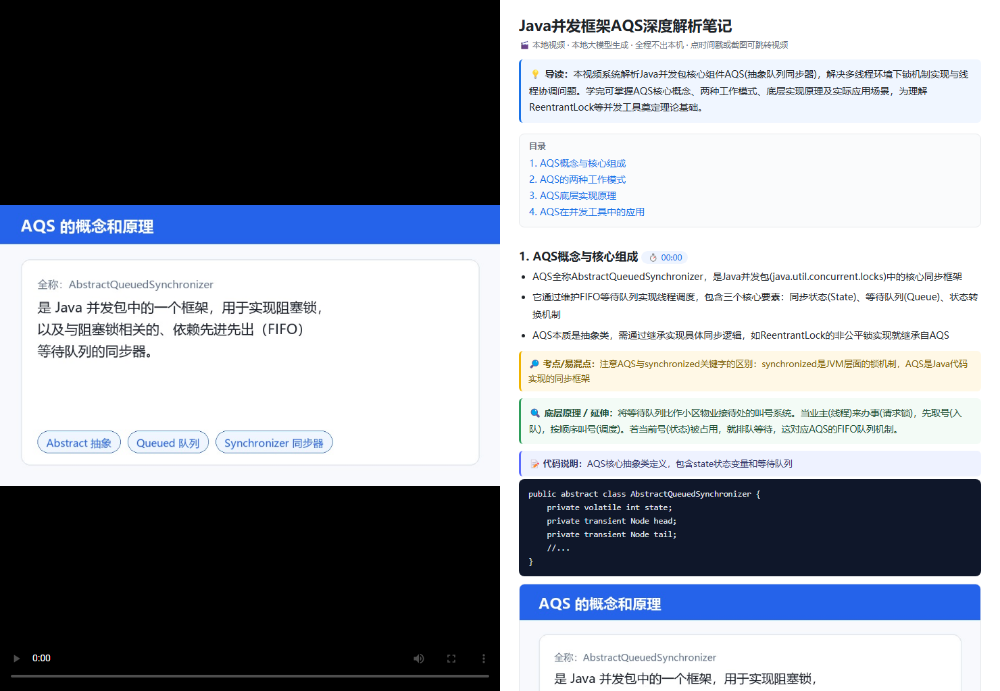

# 本地视频 → AI 富笔记（video-notes）

> 一个**纯本地、全程不出本机**的视频学习笔记生成器：把课程 / 教程 / 会议录像拖进来，自动产出"像百度网盘 AI 笔记那样、甚至更好"的图文富笔记（左视频 + 右结构化笔记，点时间戳/截图可跳视频）。
>
> 它不依赖百度网盘、不依赖任何云服务、不需要联网，全部跑在你自己的显卡和 CPU 上。

---

## 效果预览



> 上图即本工具产出的笔记界面：**左**为原视频（点时间戳或截图可跳转），**右**为 AI 生成的结构化笔记 —— 导读 → 目录 → 分节（要点 + 考点 + 生活类比讲原理 + 代码说明 + 真实代码框 + 关键帧截图）→ 知识小结表 → 自测题。
>
> 📂 **完整可交互样例**在 [`examples/`](examples/)：一份真实生成的《AQS 源码解析》课程笔记，浏览器直接打开 `examples/index.html` 就能看效果（视频区显示首帧，右侧笔记、内嵌截图、代码块均为真实产物，无需额外文件）。

---

## 一、它和"百度网盘 AI 笔记"比，强在哪

| 维度 | 百度网盘 AI 笔记 | 本工具（video-notes） |
|---|---|---|
| 数据隐私 | 视频需上传百度云端 | **全本地**，视频不出本机 |
| 依赖 | 必须开会员 / 网盘客户端 | 一次性搭好，永久免费 |
| 笔记深度 | 分节 + 截图 | 分节 + **生活类比讲底层原理** + **代码说明 + 真实代码框** + 知识小结表 + 自测题 |
| 无声视频 | 基本失效 | 可接**视觉模型 OCR 画面文字**（代码/PPT/图表）继续出文本笔记 |
| 转写速度 | 云端算力（受上传带宽限制） | **whisper.cpp + CUDA 走 GPU**，RTX 5070 实测 33~52x 实时率，2 小时视频约 4 分钟 |
| 可定制 | 不可改 | 提示词、模型、抽帧间隔、输出格式**全可改** |
| 输出格式 | 在线查看 | `index.html`（核心）+ 可选 md/docx/pptx/思维导图 |

> 实测效果：一段 6 分钟的 Java 并发课（AQS 源码），自动产出 4 个分节、4 段类比原理（volatile=物业公告牌、CAS=快递当面签收…）、4 处代码说明 + Java 代码框、知识小结表、自测题，HTML 内嵌关键帧截图。**完整样例见 [`examples/`](examples/)。**

---

## 二、整体架构（流水线）

```
视频文件
  │
  ├─[ffmpeg] 按时间间隔抽关键帧 ──────────► 截图/  (供 HTML 内嵌 + 视觉OCR)
  │
  ├─[whisper.cpp, GPU/CUDA] 听音轨转写 ───► 逐字稿.txt (带时间戳)
  │    └─ 不可用时自动回退 faster-whisper(CPU)
  │
  ├─[可选] 视觉模型(35B)看关键帧 OCR ─────► 画面识别.txt (无声/纯录屏视频救命用)
  │
  └─[本地 llama-server, OpenAI兼容] 总结 ─► 结构化JSON
        │
        └─ 组装 ──► index.html（默认） + 可选 笔记.md/docx/pptx/思维导图.mm
```

三个本地环节，互不依赖云端：
1. **抽帧**：ffmpeg（可独立下载，不需 pip）。
2. **转写**：优先 **whisper.cpp + CUDA（GPU，比 CPU 快 5~15 倍）**；不可用时自动回退 faster-whisper（CPU）。
   为什么不用 faster-whisper 的 GPU、怎么编译，见 [`docs/whisper-cuda.md`](docs/whisper-cuda.md)。
3. **总结**：你自己的 llama-server（`http://localhost:8000/v1`，任意 OpenAI 兼容后端都行）。

---

## 三、硬件与模型选型（★ 先读这章，选错模型会直接跑不起来）

> 本工具对硬件包容度很高：从 8GB 独显到纯 CPU 都能跑，只是速度和能用的模型大小不同。**两个核心约束**：① 显存大小决定能跑多大的模型；② 内存大小决定大模型超显存部分能否 offload 到内存续跑。下面按"显卡显存"分层，给出可直接照抄的型号。

### 3.1 按显存选模型（最关键的一张表）

| 显存 | 代表显卡 | 笔记总结模型（默认） | 无声视频 OCR 模型 | 两个模型能否同时加载 | 30B 总结一段 6 分钟视频的预期速度 |
|---|---|---|---|---|---|
| **6–8 GB** | RTX 3060 8G / 4060 / 笔记本 6G | **Qwen3-8B-Instruct Q4_K_M**（~5GB，全 GPU）或 Qwen3-30B-A3B **Q2_K**（~12GB，部分 offload 内存） | **Qwen2.5-VL-7B Q4_K_M**（~5GB） | 否，二选一 | 8B：慢（1–3 t/s）；30B-Q2：更慢但能跑 |
| **12 GB** | **RTX 5070 / 4070 Ti / 3060 12G** | **Qwen3-30B-A3B Q4_K_M**（18.6GB，用 `--cpu-moe` 把专家落内存） | **Qwen3.6-35B-A3B Q2_K_P**（14GB，大部分落 GPU、超出的 offload 内存） | 否，二选一 | **~29 t/s（作者 RTX 5070 实测）** |
| **16 GB** | RTX 4070 Super / 4080 | 同上（30B 能放更多层到 GPU） | 同上 | 否 | 更快 |
| **24 GB** | RTX 3090 / 4090 / **5090** | 可全 GPU 跑 30B | 可全 GPU 跑 35B | **可以！起两个 server（8000+8001）** | 全 GPU 流畅 |
| **无独显**（纯 CPU / 核显） | 任意 | Qwen3-8B（CPU 推理）或 30B-cpu（很慢） | 同左 | — | 慢，但能跑通 |

> ⚠️ **显存放不下模型 ≠ 跑不了**：llama.cpp 会自动把放不进显存的层 **offload 到内存（系统 RAM）** 继续推理。所以"12GB 显存放 18.6GB 的 30B"是成立的——只是"显存放不下部分→走内存"，速度介于纯 GPU 和纯 CPU 之间。**这意味着内存要足够大**（见 3.2）。

### 3.2 内存（RAM）要求
- 跑 30B 用 `--cpu-moe`：MoE 专家层常驻内存，约需 **20GB 空闲内存** → 最低 16GB（吃紧），**推荐 32GB+**。
- 纯 CPU 跑大模型：整个模型（30B Q4 ≈ 18GB + 开销）都要进内存，**建议 32GB+**。
- Whisper（CPU 转写）+ 系统本身：8GB 起步，16GB 舒适。

### 3.3 CPU / 指令集
- **GPU 优先**：有 NVIDIA 显卡并编好 whisper.cpp，转写直接走 GPU（快 5~15 倍，见 [`docs/whisper-cuda.md`](docs/whisper-cuda.md)）。
- **CPU 回退**：没 GPU / 编译失败时走 faster-whisper，靠多核：12 核以上很快（作者 6 分钟视频约 25 秒）；4 核以下会慢数倍。
- 需支持 **AVX2**（近 10 年 x86 CPU 都支持）；极老 CPU（2013 年前）可能缺指令集，转写变慢或报错。

### 3.4 操作系统
- **Windows**：用 `run.bat`（已按 GBK+CRLF 编码，拖拽即用）。
- **Linux / macOS**：直接用 `python make_notes.py ...` 命令；或本仓库附带的 `run.sh`（给桌面用户拖拽用）。
- **Apple Silicon Mac**：llama.cpp 用 metal 后端，统一内存（24/48/64GB）对大模型极友好（M3 Max 64GB 能跑 70B）；推荐 Qwen3-30B/32B Q4。

### 3.5 CUDA 版本（NVIDIA 用户关键，决定 Whisper 能否 GPU 加速）
- **推荐：用 whisper.cpp 做 GPU 转写**。它自带 ggml CUDA kernel，**CUDA 12 / 13 都能跑**，不挑 cublas 版本。
  编一次约 20~40 分钟，之后转写快 5~15 倍。完整步骤见 [`docs/whisper-cuda.md`](docs/whisper-cuda.md)。
- **回退：faster-whisper**（没编 whisper.cpp 时）。其底层 `ctranslate2` 预编译版要 **CUDA 12 的 `cublas64_12.dll`**：
  - 系统**装了 CUDA 12**（老驱动 / 自装 toolkit）→ 可 `--device cuda` 加速；
  - **只有 CUDA 13**（50 系新卡默认，只有 `cublas64_13.dll`）→ 缺 `cublas64_12` → 只能 CPU。
- 自查：看 `C:\Program Files\NVIDIA GPU Computing Toolkit\CUDA\` 下有没有 `v12.x` 目录。
- llama.cpp 也要下**和你显卡/驱动匹配的 CUDA 构建**（CUDA 12.x / 13.x / ROCm / SYCL / metal / 纯 CPU），不是随便下。

### 3.6 大模型怎么下载（30B / 35B 都是十几 GB）
- 国内推荐：**魔搭 ModelScope** 或 **hf-mirror.com** + 迅雷 / aria2c 多线程拉（比浏览器稳）。
- 技巧：把模型仓库 URL 里的 `huggingface.co` 换成 `hf-mirror.com` 即可走镜像。
- 详细见 [`docs/llama-setup.md`](docs/llama-setup.md)。

### 3.7 端口
- 本地大模型默认监听 `http://localhost:8000/v1`。若 8000 被占用（如其他服务），改端口后用 `--llm-base http://localhost:你的端口/v1`。

### 3.8 软件依赖一览
| 组件 | 说明 | 备注 |
|---|---|---|
| Python | **3.11 / 3.12 最稳**（ctranslate2 支持好）；3.13 偏新可能无对应 wheel | 务必用 venv 隔离 |
| ffmpeg | 独立二进制，放 `tools/ffmpeg/bin/` 或系统 PATH | 不需 pip |
| whisper.cpp（可选，推荐） | GPU 转写引擎（whisper-cli.exe），需自行编译 | CUDA 12/13 均可；见 `docs/whisper-cuda.md` |
| faster-whisper | CPU 转写（whisper.cpp 不可用时的回退） | 有 CUDA 12 可 `--device cuda` 加速 |
| 本地大模型 | 任意 OpenAI 兼容服务（llama.cpp / ollama / vllm），监听 8000 | 见 3.6 |

> 📁 **作者的真实环境（供参考，不必照搬）**：RTX 5070 12GB / CUDA 13.3 / Ryzen 9 9900X 12 核 / 47GB RAM；llama.cpp **CUDA 13.3 构建（build 9828）** + 自写 `启动大模型.bat` 菜单（先选 35B/30B 再选模式）+ Qwen3-30B-A3B Q4_K_M（笔记）与 Qwen3.6-35B-A3B Q2_K_P（OCR）。**你只要有任意 OpenAI 兼容本地服务监听 `localhost:8000` 就能跑**，完整总结见 [`docs/llama-setup.md`](docs/llama-setup.md)。

---

## 四、搭建步骤（照做即可）

### 1. 准备 Python 隔离环境
```bash
cd video-notes
python -m venv .venv
.venv\Scripts\activate        # Windows
pip install -r requirements.txt
```

### 2. 放好 ffmpeg
- 下载 [ffmpeg](https://www.gyan.dev/ffmpeg/builds/)（Windows essentials 版），解压。
- 放到 `tools/ffmpeg/`（使 `tools/ffmpeg/bin/ffmpeg.exe` 存在），或把 bin 目录加入系统 PATH。

### 3. 放好转写模型（听音轨用）

**方案 A（推荐，GPU）：whisper.cpp**
- 按 [`docs/whisper-cuda.md`](docs/whisper-cuda.md) 编译出 `whisper-cli.exe`，并把 `ggml-small.bin` 放到 `tools/whispercpp/models/`。
  一句话版：
  ```bat
  git clone --depth 1 https://github.com/ggml-org/whisper.cpp tools\whispercpp
  scripts\build_whisper_cuda.bat
  curl -L -o tools\whispercpp\models\ggml-small.bin https://hf-mirror.com/ggerganov/whisper.cpp/resolve/main/ggml-small.bin
  ```
- 脚本会自动优先用它，转写走 GPU，快 5~15 倍。

**方案 B（回退，CPU）：faster-whisper**
- 没编 whisper.cpp 时自动回退到它。脚本会**优先用本地 `models/faster-whisper-<name>/` 目录**（需含 `model.bin`）；没有才让 faster-whisper 自己下载（国内可能被墙，见坑 3）。
- **推荐用 huggingface-cli 走镜像一次下好**（命令在激活的 venv 里执行）：
  ```bash
  pip install -U "huggingface_hub[cli]"
  set HF_ENDPOINT=https://hf-mirror.com        # Windows；macOS/Linux 用: export HF_ENDPOINT=https://hf-mirror.com
  huggingface-cli download Systran/faster-whisper-base --local-dir models/faster-whisper-base
  huggingface-cli download Systran/faster-whisper-tiny --local-dir models/faster-whisper-tiny
  ```
  > 这两条命令会把 `model.bin` / `config.json` / `tokenizer*` 等整套文件落到 `models/faster-whisper-base/` 下，脚本可直接识别。

### 4. 启动本地大模型服务
- 用你自己的方式起一个 OpenAI 兼容服务，监听 `http://localhost:8000/v1`。
- 例子（llama.cpp）：`llama-server -m 你的模型.gguf --port 8000`。
- 想做无声视频 OCR，加载**带视觉的模型**（如 35B）。

### 5. 跑起来
- **最简单**：把视频 / 文件夹**拖到 `run.bat`** 上。
- 或命令行：
```bash
# 单个视频（默认只生成 index.html）
.venv\Scripts\python.exe make_notes.py "D:/课程/第1讲.mp4"

# 整个文件夹（递归，按源路径镜像到 output/）
.venv\Scripts\python.exe make_notes.py "D:/课程合集"

# 无声/纯录屏视频：自动触发视觉OCR（需已加载视觉模型）
.venv\Scripts\python.exe make_notes.py "D:/录屏/无旁白demo.mp4" --vision

# 调提示词后快速重跑（复用已有转写稿/截图，跳过转写）
.venv\Scripts\python.exe make_notes.py "D:/课程/第1讲.mp4" --reuse

# 额外生成 md/docx/pptx/思维导图（默认只出 HTML）
.venv\Scripts\python.exe make_notes.py "D:/课程/第1讲.mp4" --all-formats
```

产出在 `output/<镜像你的源路径>/<视频名>_notes/`：
```
index.html        ← 核心交付，浏览器打开，左视频右笔记
逐字稿.txt        ← 原始转写（--reuse 依赖它）
截图/             ← 关键帧
画面识别.txt      ← 视觉OCR结果（仅无声/--vision 时）
笔记.md/docx/pptx/思维导图.mm  ← 仅 --all-formats 时
```

### 4.1 一次处理多个路径（告别「监工」）

**场景**：你有一堆视频分散在不同文件夹（比如 `rk0957-黑马...` 下的 5 个子目录），不想一个个盯着跑完再开下一个。

**方式一（最省事）：直接拖「父文件夹」**
工具会**递归**扫描所有子目录里的视频，在同一个 `run.bat` 会话里**一口气按顺序全跑完**。对上面的例子，把
`D:\baiduyunpan\rk0957-黑马博学谷-Java并发编程进阶技术实践` 整个拖给 `run.bat` 即可，5 个子文件夹的视频自动排队处理，你走开就行。
> 不用担心「文件夹太大」：工具只读扫描、只挑视频扩展名，文档/代码/安装包都会被忽略；真想先看看会抓到哪些，加 `--dry-run` 预览。

**方式二（路径分散在不同位置）：用队列文件**
1. 把本仓库的 `queue_example.txt` 复制成 `queue.txt`；
2. 每行写一个视频/文件夹的**完整路径**（# 开头是注释，空行忽略，文件/文件夹可混写）：
   ```
   D:\baiduyunpan\rk0957-黑马博学谷-Java并发编程进阶技术实践\01 第一章 同步器AQS\01 AQS的概念和原理
   D:\baiduyunpan\rk0957-黑马博学谷-Java并发编程进阶技术实践\02 第二章 锁的使用
   D:\其他课程\数据库精讲\第3讲.mp4
   ```
3. 把 `queue.txt` **拖到 `run.bat`** 上 → 自动进入队列模式，按顺序逐个路径跑完。

**断点续跑**：每个视频完成后会生成 `index.html` 作为完成标记。中途崩了 / 关机了，重新拖同一个 `queue.txt` 即可——已生成的会被自动跳过，只跑剩下的。也支持 `--force` 强制重跑、`--reuse` 复用转写稿。

### 4.2 纯字幕 / 逐字稿模式（没有视频也能出笔记）

**场景**：你手上只有一份字幕 / 逐字稿（`.txt`），没有对应的视频文件，或者不想再走一遍转写。直接把它喂进来即可，**跳过抽帧、跳过 Whisper 转写、跳过视觉 OCR**，只调用本地大模型做总结，照样产出 `index.html`（左侧显示「纯字幕模式」占位面板，不再有视频播放器）。

**支持的文本格式**（自动识别）：
- **Whisper 风格**：每行 `[mm:ss] 文本` 或 `[hh:mm:ss] 文本`
- **SRT 字幕**：`00:00:01,000 --> 00:00:03,000` 时间轴格式
- **LRC 歌词式**：`[00:00.50] 文本`
- **纯文本**：没有时间戳也行，整段作为一节处理

```bash
# 方式一：直接拖字幕 .txt 到 run.bat（会自动识别为「字幕」而非「队列清单」）
# 方式二：命令行显式指定
.venv\Scripts\python.exe make_notes.py --transcript "D:/课程/第1讲字幕.txt"

# 多个字幕一次性处理
.venv\Scripts\python.exe make_notes.py --transcript a.txt b.txt c.txt

# 先预览会识别成什么，不真正处理
.venv\Scripts\python.exe make_notes.py --transcript "D:/课程/第1讲字幕.txt" --dry-run
```
> 注：`.txt` 文件会被**自动判别**——如果内容看起来像一堆视频路径（队列清单），就按队列跑；否则按字幕跑。想强制当字幕，用 `--transcript`。

---

## 五、常用参数

| 参数 | 作用 |
|---|---|
| `--out <目录>` | 指定总输出根（默认 `output/`）。**别传完整的 `_notes` 路径**，否则会套两层目录。 |
| `--reuse` | 复用已有转写稿/截图/画面识别，跳过转写，调提示词时秒级重跑。 |
| `--vision` | 强制开启视觉 OCR（即使有声音，也想识别画面代码/PPT 时）。 |
| `--frame-interval 15` | 抽帧间隔秒数（默认 30；想更密改 15）。 |
| `--mirror-from "D:\baiduyunpan"` | 输出目录从指定层级开始镜像（去掉同步盘前缀）。 |
| `--all-formats` | 额外生成 笔记.md/docx/pptx/思维导图.mm。 |
| `--no-llm` | 只做抽帧+转写，不调大模型（调试用）。 |
| `--dry-run` | **大文件夹专用**：只扫描并列出将要处理的视频清单+数量，不调 Whisper/LLM。丢 200G 大目录前先跑它预览，确认没误抓软件自带视频。找到 >50 个视频会自动提示用本参数；>300 个会要求 y/N 确认。 |
| `--device cuda` / `--device cpu` | 转写设备。**默认 `cuda`**：先试 whisper.cpp(GPU)，失败自动回退 CPU；`--device cpu` 强制 CPU。 |
| `--whisper-cpp-model <路径>` | 指定 whisper.cpp 的 ggml 模型，默认 `tools/whispercpp/models/ggml-small.bin`（准确优先）；想更快可换 `ggml-base.bin`。 |
| `--llm-base / --llm-model` | 改大模型端点 / 模型名（接 ollama 等时用）。 |
| `--transcript <file> [file2 ...]` | **纯字幕/逐字稿模式**：直接传入 `.txt`（支持 whisper/SRT/LRC/纯文本），跳过抽帧与转写，仅用大模型做总结生成 `index.html`；拖入字幕 `.txt` 也会自动识别。 |
| `--vision-url / --vision-model` | 视觉 OCR 用独立端点（如另起 35B 于 8001）。 |

---

## 六、🔥 踩坑经验（复刻必须看，否则必卡）

这些是本工具从 0 到 1 全部踩过的真坑，按坑处理就不会走弯路：

### 坑 1：`cublas64_12.dll not found` —— faster-whisper 的 GPU 门槛
- **现象**：`--device cuda` 报 `cublas64_12.dll not found` 或直接卡死。
- **原因**：`ctranslate2` 预编译 wheel 写死要 **CUDA 12 的 `cublas64_12.dll`**；而 50 系新卡（CUDA 13）只有 `cublas64_13.dll`。
- **解决**：**换 whisper.cpp**（自带 CUDA kernel，CUDA 12/13 都能跑）→ 见 [`docs/whisper-cuda.md`](docs/whisper-cuda.md)。
  本项目**默认就优先 whisper.cpp，失败自动回退 faster-whisper CPU**，所以你不会被这个卡死。
- **不想编译的临时折中**：有 CUDA 12 就给 faster-whisper 加 `--device cuda`；只有 CUDA 13 就走 CPU（作者 12 核转写 6 分钟视频约 25 秒，可接受）。
- **实测收益**：换 whisper.cpp 后，RTX 5070 上 74 秒音频：base 1.43 秒(~52x)、small 2.25 秒(~33x)，比 CPU 快 5~15 倍。

### 坑 2：Windows 的 `.bat` 必须 GBK + CRLF（缺一不可）
- **现象 A（只有 UTF-8 编码）**：中文乱码，报"不是内部或外部命令"。
- **现象 B（GBK 但行尾是 LF）**：命令从词中间断掉，如 `echo`→`'cho'`、`选择`→`'择'`，诡异报错。
- **根因**：cmd 默认 936(GBK) 解析；GBK 汉字双字节，LF 行尾会让 cmd 错位解析，半个汉字被并到下一行。
- **解决**：生成 bat 用二进制写 `("\r\n".join(lines)).encode("gbk")`，**绝不能用文本模式 `\n` 拼接**。本仓库 `run.bat` 已是正确格式。

### 坑 3：HuggingFace 大文件被代理截断
- **现象**：whisper 模型下载到一半变 0 字节 / 半截，转写直接失败。
- **原因**：直连 HF 被网络代理截断。
- **解决**：用 `curl` 走镜像 `https://hf-mirror.com` 预置模型到本地 `models/`，脚本优先读本地，根本不触发下载。（见上文步骤 3）

### 坑 4：视频与输出跨盘符时 HTML 打不开
- **现象**：视频在 `D:`，输出在 `F:`，`index.html` 的视频 `<source>` 是相对路径导致无法播放甚至生成失败。
- **解决**：`video_src_for_html()` 检测到跨盘符时**回退到 `file://` 绝对路径**。

### 坑 5：用户粘贴的路径带引号 / `file://` 前缀
- **现象**：从资源管理器/浏览器复制路径，常带首尾 `"..."` 或 `file:///` 前缀，直接当路径用会"文件不存在"甚至 bat 因引号语法崩。
- **解决**：入口 `clean_input_path()` 同时去掉首尾引号和 `file:///` 前缀。

### 坑 6：Office 占用导致 docx/pptx 写不进
- **现象**：生成的 docx/pptx 正被 Word/PPT 打开，写入 `PermissionError`。
- **解决**：`_save_office()` 捕获后**自动另存为 `xxx_new.ext`**，不静默丢产物。（默认只出 HTML 后此问题基本不触发）

### 坑 7：大模型 `max_tokens` 太小把笔记截断
- **现象**：笔记只有半截、分节不全。
- **原因**：旧值 2048 不够。
- **解决**：放开到 `LLM_MAX_TOKENS = 7000`；本机 llama-server 上下文 16384 撑得住。

### 坑 8：视觉 OCR 与笔记共用一个端点，但显存只能二选一
- **现象**：跑无声视频 OCR 时，若加载的是纯文本 30B，视觉调用会失败、无声视频笔记为空。
- **解决**：处理无声/纯录屏视频前，先在模型启动器里**选带视觉的 35B**。12GB 显存放不下两个模型同驻。

---

## 七、目录结构（本仓库）

```
video-notes/
├─ make_notes.py        ← 核心流水线（纯标准库 + 惰性导入第三方）
├─ run.bat              ← Windows 启动器（ASCII+CRLF，拖拽即用）
├─ requirements.txt     ← Python 依赖（CPU 回退链）
├─ README.md            ← 你正在看的这份
├─ SKILL.md             ← WorkBuddy 技能卡：让你的 AI 助手读它能照着复刻
├─ docs/
│   ├─ llama-setup.md   ← 作者真实大模型环境（llama.cpp CUDA13.3 + 启动器 + 模型）总结
│   └─ whisper-cuda.md  ← ★ GPU 转写：为什么用 whisper.cpp、怎么编译、实测速度、DLL 坑
├─ scripts/
│   ├─ build_whisper_cuda.bat   ← Windows 一键编译 whisper.cpp(CUDA)
│   └─ build_whisper_cuda.sh    ← Linux/macOS 编译脚本
├─ skills/
│   └─ story-taught-tech-new/  ← 知识讲解 skill（笔记"类比讲原理"的能力来源，可让 AI 复用）
├─ examples/            ← 示例笔记（真实生成的 AQS 课程笔记：index.html + 截图/ + 逐字稿.txt）
│   └─ assets/preview.png  ← README 顶部的效果图
├─ .gitignore           ← 排除 .venv/tools/models/output 等大文件
├─ tools/ffmpeg/        ← [需自己放] ffmpeg 二进制
├─ tools/whispercpp/    ← [需自己编] whisper.cpp 源码 → build/bin/whisper-cli.exe + models/ggml-*.bin
├─ models/              ← [需自己放] faster-whisper 模型（CPU 回退用）
└─ output/              ← [自动生成] 笔记产物
```

---

## 八、给 WorkBuddy / 其他 AI 助手的话

如果你（或你的 AI 助手）拿到这个仓库想复刻：**直接读 `SKILL.md`**。它把上面的架构、参数、八个坑都结构化了，照着做就能在你的机器上重建出同样效果的工具，无需从头踩坑。

---

## 九、License

MIT —— 随便改、随便用，注明出处即可。
